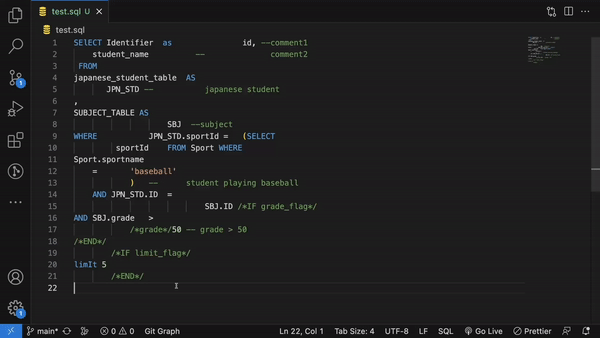

# uroboroSQL-fmt for VSCode




A Visual Studio Code extension for [uroboroSQL-fmt](https://github.com/future-architect/uroborosql-fmt) that is a tool that formats SQL statements according to [SQL coding standards created by Future Corporation](https://future-architect.github.io/coding-standards/documents/forSQL/SQL%E3%82%B3%E3%83%BC%E3%83%87%E3%82%A3%E3%83%B3%E3%82%B0%E8%A6%8F%E7%B4%84%EF%BC%88PostgreSQL%EF%BC%89.html) (Japanese only).

## Features

- Format SQL documents and selections.
- Format SQL embedded in non-SQL files via the `Format Selection as SQL` command.
- Lint diagnostics for SQL files, shown when a lint configuration can be resolved. See [Lint](#lint-beta).
- Checks that tables and columns exist in your PostgreSQL schema (catalog checks, Beta).
- Quick fixes for lint diagnostics (add a `uroborosql-lint-disable-next-line` directive, or remove an unknown rule name from a directive).
- Per-folder formatter and lint configuration resolution in multi-root workspaces.

## Usage

Once installed in Visual Studio Code, "uroborosql-fmt" will be available as a formatter for SQL files. Please select "uroborosql-fmt" (extension id:`Future.uroborosql-fmt`) as the default formatter. You can do this either by using the context menu (right click on a open SQL file in the editor) and select "Format Document With...", or you can add the following to your settings:

```json
{
  "[sql]": {
    "editor.defaultFormatter": "Future.uroborosql-fmt"
  }
}
```

### Format on save

You can enable format on save for SQL by having the following values in your settings:

```json
{
  "[sql]": {
    "editor.defaultFormatter": "Future.uroborosql-fmt",
    "editor.formatOnSave": true
  }
}
```

## Lint (Beta)

Lint diagnostics are shown only when a lint configuration file is found. Without one, the extension only formats and never connects to a database.

1. Create `.uroborosqllintrc.json` in the workspace folder. An empty object enables all rules with their default severities:

   ```json
   {}
   ```

   You can also create it with `uroborosql-lint --init` if you have the [`uroborosql-lint` CLI](https://github.com/future-architect/uroborosql-fmt/tree/main/crates/uroborosql-lint-cli). To use a file in another location, set `uroborosql-fmt.lintConfigurationFilePath`.

2. Open or save a SQL file. Diagnostics appear in the editor and the Problems panel. Lint runs on open and save, not while typing.

If the lint configuration file cannot be read (for example, invalid JSON), no lint diagnostics are shown and the reason is written to the `Uroborosql-fmt` output channel. Formatting keeps working.

Use `rules` to change severities (`off` / `warn` / `error`), `ignore` to skip files, and `overrides` for per-file settings:

```json
{
  "rules": {
    "no-distinct": "error",
    "no-wildcard-projection": "off"
  },
  "ignore": ["dist/**"]
}
```

See the [`uroborosql-lint` README](https://github.com/future-architect/uroborosql-fmt/tree/main/crates/uroborosql-lint) for the list of rules, their default severities, and all configuration options. To suppress a diagnostic for one line, use the quick fix or write `-- uroborosql-lint-disable-next-line <rule>` above it.

### Catalog checks

Lint rules are either rules that check the SQL alone or rules that also use the database catalog. The [rule list](https://github.com/future-architect/uroborosql-fmt/tree/main/crates/uroborosql-lint#rules) shows which rules use the catalog. Rules that use the catalog run only when the lint configuration has a `db` section; without one, no database is read. SQL is never executed.

There are two ways to provide the catalog.

**Catalog snapshot (recommended for regular use).** Someone with database access exports a SQLite snapshot with the `uroborosql-lint` CLI and shares it, for example by committing it to the repository. The snapshot contains object names, not data rows or passwords.

```sh
uroborosql-lint export-catalog --host localhost --user catalog_reader --dbname app --output catalog.sqlite
```

```json
{
  "db": {
    "schemaProvider": "file",
    "path": "catalog.sqlite"
  }
}
```

`path` is relative to the directory of the lint configuration file. The editor needs no database connection or credentials. The snapshot is not updated automatically; export it again after schema changes. The new snapshot is used from the next open or save.

**Direct connection.** Useful for trying catalog checks out. The extension connects to PostgreSQL 14–18 on every check.

```json
{
  "db": {
    "schemaProvider": "server",
    "host": "localhost",
    "user": "catalog_reader",
    "dbname": "app",
    "tlsMode": "disable"
  }
}
```

The password is read from the `PGPASSWORD` environment variable of the VS Code process (pgpass files are not read), and the search path can be set with `PGOPTIONS` (for example `-c search_path=app,public`).

`tlsMode` sets how the connection uses TLS:

- `verify-full` (default): encrypts and verifies the server certificate and host name.
- `verify-ca`: encrypts and verifies the server certificate.
- `require`: encrypts without verifying the certificate.
- `disable`: does not use TLS.

> [!NOTE]
> **Beta limitation:** Only single-table `SELECT` statements are checked against the catalog. Other statements, including `JOIN`, subqueries, and `INSERT` / `UPDATE` / `DELETE`, are skipped without a diagnostic. The `Uroborosql-fmt` output channel lists each skipped statement as `path:line:column: not checked against the catalog (reason)`.

## Settings

| Settings                                 | Defaults | Description                                                                                                                                                                                                                                                                                               |
| ---------------------------------------- | -------- | --------------------------------------------------------------------------------------------------------------------------------------------------------------------------------------------------------------------------------------------------------------------------------------------------------- |
| uroborosql-fmt.configurationFilePath     | null     | The path of configuration file. File extension must be `.json`. If you don't specify the path and `./.uroborosqlfmtrc.json` exists, formatter will use `./.uroborosqlfmtrc.json`. If you doesn't specify and `.uroborosqlfmtrc.json` doesn't exist, formatter will use formatters default configurations. |
| uroborosql-fmt.lintConfigurationFilePath | null     | The path of lint configuration file. File extension must be `.json`. If you don't specify the path, lint will use `./.uroborosqllintrc.json` when it exists. Lint diagnostics are published only when a lint configuration can be resolved.                                                               |

### Configuration options

```json
{
  "debug": false,
  "tab_size": 4,
  "complement_alias": true,
  "trim_bind_param": false,
  "keyword_case": "preserve",
  "identifier_case": "preserve",
  "max_char_per_line": 50,
  "complement_outer_keyword": true,
  "complement_column_as_keyword": true,
  "remove_table_as_keyword": true,
  "remove_redundant_nest": true,
  "complement_sql_id": true,
  "convert_double_colon_cast": false,
  "unify_not_equal": true,
  "indent_tab": true,
  "use_parser_error_recovery": true
}
```

Create `.uroborosqlfmtrc.json` in the directory where you run the command and write the configuration there.

If there is no configuration file, the default values are used.

| name                                                                                                                                        | type                                 | description                                                                                                                                                                                                                                            | default |
| ------------------------------------------------------------------------------------------------------------------------------------------- | ------------------------------------ | ------------------------------------------------------------------------------------------------------------------------------------------------------------------------------------------------------------------------------------------------------ | ------- |
| [`debug`](https://github.com/future-architect/uroborosql-fmt/blob/main/docs/options/debug.md)                                               | bool                                 | Run in debug mode.                                                                                                                                                                                                                                     | false   |
| [`tab_size`](https://github.com/future-architect/uroborosql-fmt/blob/main/docs/options/tab_size.md)                                         | int                                  | Tab size used for formatting.                                                                                                                                                                                                                          | 4       |
| [`complement_alias`](https://github.com/future-architect/uroborosql-fmt/blob/main/docs/options/complement_alias.md)                         | bool                                 | Complement aliases. Currently, column names are auto-completed with the same name. (e.g. `COL1` → `COL1 AS COL1`)                                                                                                                                      | true    |
| [`trim_bind_param`](https://github.com/future-architect/uroborosql-fmt/blob/main/docs/options/trim_bind_param.md)                           | bool                                 | Trim the contents of the [bind parameters](https://future-architect.github.io/uroborosql-doc/background/#%E3%83%8F%E3%82%99%E3%82%A4%E3%83%B3%E3%83%88%E3%82%99%E3%83%8F%E3%82%9A%E3%83%A9%E3%83%A1%E3%83%BC%E3%82%BF). (e.g. `/* foo */` → `/*foo*/`) | false   |
| [`keyword_case`](https://github.com/future-architect/uroborosql-fmt/blob/main/docs/options/keyword_case.md)                                 | [`"upper"`, `"lower"`, `"preserve"`] | Unify the case of keywords. (No conversion in case of `"preserve"`)                                                                                                                                                                                    | lower   |
| [`identifier_case`](https://github.com/future-architect/uroborosql-fmt/blob/main/docs/options/identifier_case.md)                           | [`"upper"`, `"lower"`, `"preserve"`] | Unify the case of identifiers. (No conversion in case of `"preserve"`)                                                                                                                                                                                 | lower   |
| [`max_char_per_line`](https://github.com/future-architect/uroborosql-fmt/blob/main/docs/options/max_char_per_line.md)                       | int                                  | If the total number of characters in the function name and arguments exceeds `max_char_per_line`, the arguments are formatted with new lines.                                                                                                          | 50      |
| [`complement_outer_keyword`](https://github.com/future-architect/uroborosql-fmt/blob/main/docs/options/complement_outer_keyword.md)         | bool                                 | Complement the optional `OUTER`. (e.g. `LEFT JOIN` → `LEFT OUTER JOIN`)                                                                                                                                                                                | true    |
| [`complement_column_as_keyword`](https://github.com/future-architect/uroborosql-fmt/blob/main/docs/options/complement_column_as_keyword.md) | bool                                 | Complement `AS` in column aliases.                                                                                                                                                                                                                     | true    |
| [`remove_table_as_keyword`](https://github.com/future-architect/uroborosql-fmt/blob/main/docs/options/remove_table_as_keyword.md)           | bool                                 | Remove `AS` in table aliases.                                                                                                                                                                                                                          | true    |
| [`remove_redundant_nest`](https://github.com/future-architect/uroborosql-fmt/blob/main/docs/options/remove_redundant_nest.md)               | bool                                 | Remove redundant parentheses. (e.g. `(((foo)))` → `(foo)`)                                                                                                                                                                                             | true    |
| [`complement_sql_id`](https://github.com/future-architect/uroborosql-fmt/blob/main/docs/options/complement_sql_id.md)                       | bool                                 | Complement [SQL ID](https://palette-doc.rtfa.as/coding-standards/forSQL/SQL%E3%82%B3%E3%83%BC%E3%83%87%E3%82%A3%E3%83%B3%E3%82%B0%E8%A6%8F%E7%B4%84%EF%BC%88uroboroSQL%EF%BC%89.html#sql-%E8%AD%98%E5%88%A5%E5%AD%90).                                 | false   |
| [`convert_double_colon_cast`](https://github.com/future-architect/uroborosql-fmt/blob/main/docs/options/convert_double_colon_cast.md)       | bool                                 | Convert casts by `X::type` to the form `CAST(X AS type)`.                                                                                                                                                                                              | true    |
| [`unify_not_equal`](https://github.com/future-architect/uroborosql-fmt/blob/main/docs/options/unify_not_equal.md)                           | bool                                 | Convert comparison operator `<>` to `!=`                                                                                                                                                                                                               | true    |
| [`indent_tab`](https://github.com/future-architect/uroborosql-fmt/blob/main/docs/options/indent_tab.md)                                     | bool                                 | Switch the indentation style between tabs and spaces.                                                                                                                                                                                                  | true    |
| [`use_parser_error_recovery`](https://github.com/future-architect/uroborosql-fmt/blob/main/docs/options/use_parser_error_recovery.md)       | bool                                 | Enable error recovery in the SQL parser.                                                                                                                                                                                                               | true    |

## Available Commands

| command title                                                | description                                                                                                                                                                                                                                                                                                                                      |
| ------------------------------------------------------------ | ------------------------------------------------------------------------------------------------------------------------------------------------------------------------------------------------------------------------------------------------------------------------------------------------------------------------------------------------ |
| Format SQL                                                   | You can trigger formatting by executing this command.                                                                                                                                                                                                                                                                                            |
| Format Selection as SQL                                      | Formats the selected text as SQL and replaces only that range. Useful for SQL embedded in non-SQL files (e.g. a template literal in TypeScript). Requires a non-empty, non-overlapping selection.                                                                                                                                                |
| Export workspace config to uroborosql-fmt config file        | You can export workspace configurations to formatter's configuration file (specified in [uroborosql-fmt.configurationFilePath](https://github.com/future-architect/vscode-uroborosql-fmt/#:~:text=uroborosql%2Dfmt.configurationFilePath)). Only the non-null configurations in `settings.json` will overwrite those in `.uroborosqlfmtrc.json`. |
| Import uroborosql-fmt config file config to workspace config | You can import formatter's configuration into workspace configuration. Configuration values that exist in `settings.json`, but not in `.uroborosqlfmtrc.json`, will be set to `null`.                                                                                                                                                            |
| Import uroborosql-fmt config file config to global config    | You can import formatter's configuration into global configuration. Configuration values that exist in `settings.json`, but not in `.uroborosqlfmtrc.json`, will be set to `null`.                                                                                                                                                               |

## License

[Business Source License 1.1](https://github.com/future-architect/vscode-uroborosql-fmt/blob/main/LICENSE)
